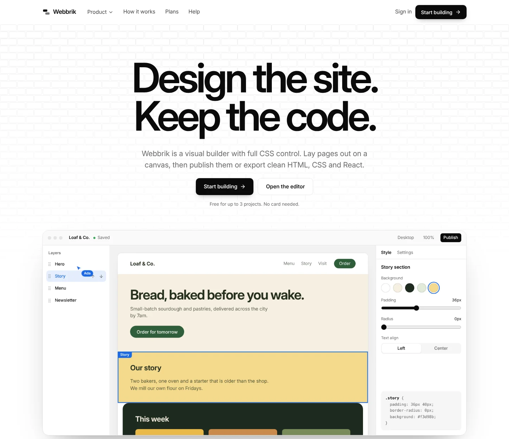
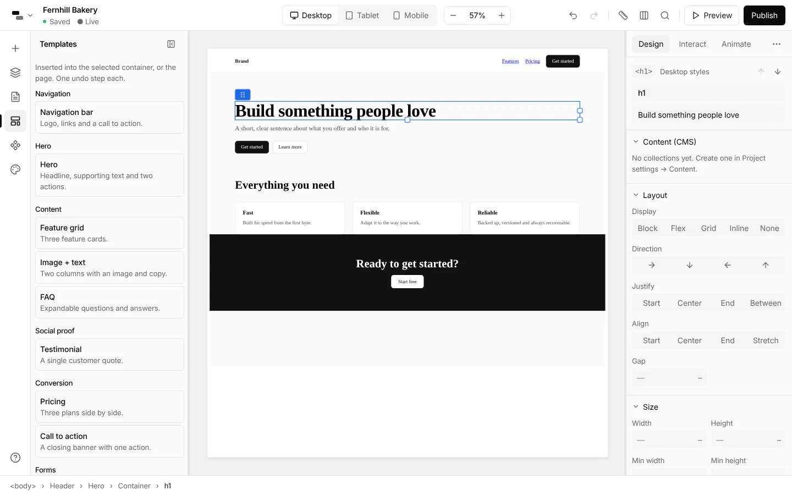
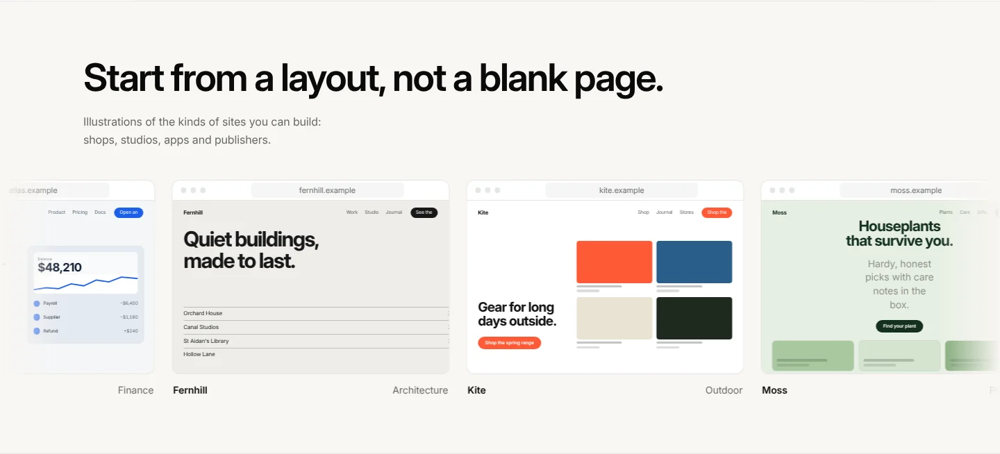
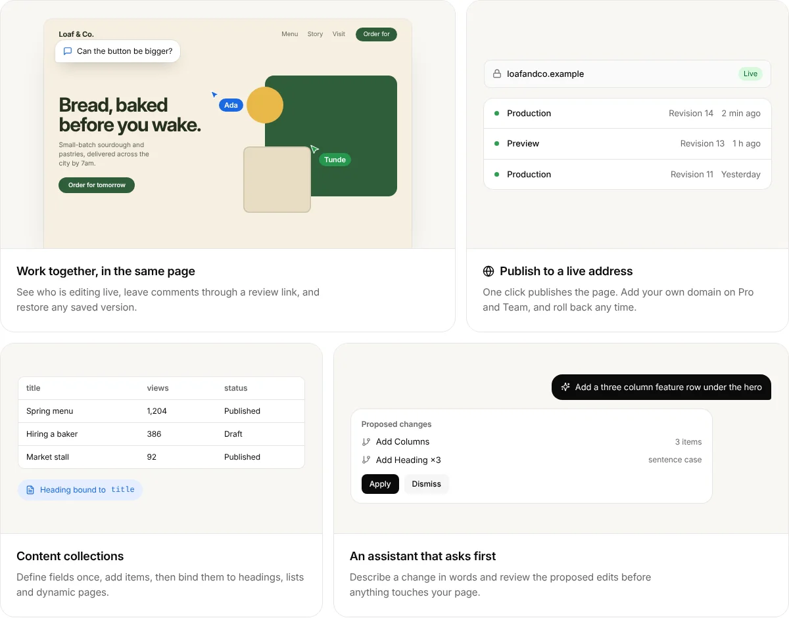
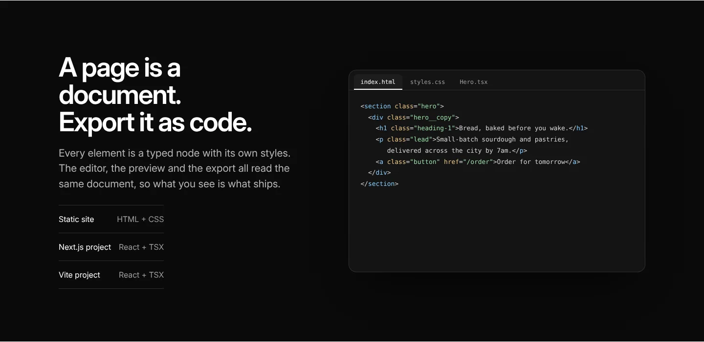
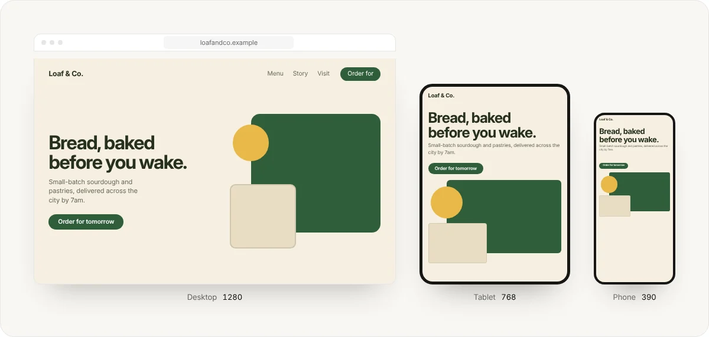
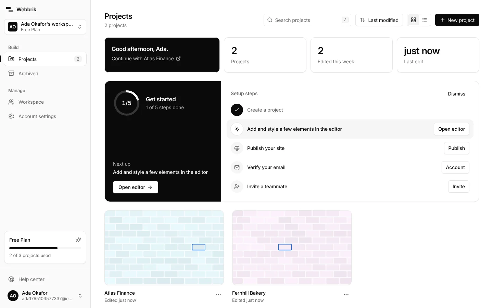
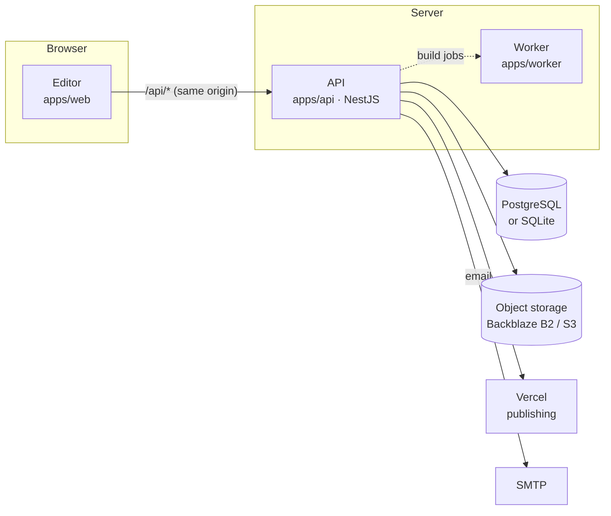

<div align="center">

<picture>
  <source media="(prefers-color-scheme: dark)" srcset="docs/images/logo-dark.svg">
  
</picture>

### Design the site. Keep the code.

A visual website builder with full CSS control. Lay pages out on a canvas, publish them in one click, or export clean HTML, CSS and React.

[](https://github.com/DivineAde/webbrik/actions/workflows/ci.yml)
[](LICENSE)


[Quick start](#quick-start) · [Features](#what-you-can-do) · [How it works](#how-it-works) · [Deploy](#deploy) · [Docs](#documentation)

<br>



</div>

<br>

## Why Webbrik

Most visual builders trade control for speed: you get a canvas, but the CSS underneath is out of reach and the export is a lock-in. Webbrik keeps both.

- **The page is a document.** Every element is a typed node with its own styles. The editor, the preview and the export all read the same document, so what you see is what ships.
- **You own the output.** Export a static site, a Next.js project or a Vite project. The code is readable and has no runtime that depends on Webbrik.
- **Safe by construction.** Styles are sanitised, custom code runs isolated, uploads are checked by their real file type, and AI suggestions are validated before they can touch your page.

## What you can do

### Build on a real canvas



- Drag components and templates onto the canvas or the layers panel, multi-select, resize with snap guides, and edit text in place.
- Set every CSS property from a design panel: layout, size, spacing, position, typography, backgrounds, borders and effects, per breakpoint and per state.
- Compare desktop, tablet and mobile side by side. Undo and redo everything. Press <kbd>⌘</kbd>/<kbd>Ctrl</kbd> + <kbd>K</kbd> for the command palette.
- Add animations and interactions without code, with reduced-motion handled for you.
- Check quality as you go: accessibility, structure and performance hints in a dedicated panel.

### Start from a layout, not a blank page



Ten ready-made sections (navigation, hero, feature grid, pricing, FAQ, contact form and more), a component system with reusable instances, and design tokens for colour and type.

### Work with a team



- **Live collaboration:** see who is editing, leave comments through a review link, compare any two versions visually, and restore one safely.
- **Content collections:** define fields once, add items, and bind them to headings, lists and dynamic pages such as `/blog/:slug`.
- **An assistant that asks first:** describe a change in words and review the proposed edits. Invalid suggestions never reach the document.
- **Workspaces and roles:** invitations, member roles, plan limits, an activity log, two-factor sign-in and Paystack billing.

### Publish, or take the code with you



One click publishes to a live address through Vercel, with previews, rollbacks, custom domains, environment secrets and webhooks. Prefer to host it yourself? Export a static site, a Next.js project or a Vite project as a zip.



### Manage everything from one dashboard



## How it works



The engine is a set of small TypeScript packages that the web app and the API share:

| Package | What it does |
|---|---|
| `document-model` | The page schema, 30 operations, validation, history and diff |
| `css-engine` | Compiles styles with states, breakpoints and keyframes; sanitises input |
| `renderer`, `exporter` | Renders a document safely and exports static, React, Next.js and Vite code |
| `editor-core`, `collaboration` | Local and remote documents, offline retry, crash recovery, server-ordered operations |
| `component-system`, `design-system` | Templates, reusable components and design tokens |
| `content-engine` | Collections, bindings, repeaters and dynamic pages |
| `interactions`, `quality`, `ai` | Animations, quality checks and the AI proposal gate |
| `assets`, `deployment`, `integrations`, `plugins` | Uploads, publishing, outside services and the plugin SDK |

## Quick start

You need Node 22 and pnpm 9 (`corepack enable`). Nothing else: without a database the API keeps data in memory.

```bash
git clone https://github.com/DivineAde/webbrik.git
cd webbrik
pnpm install

# 1. the API (data is saved to a file; leave SQLITE_PATH out for in-memory)
SQLITE_PATH=./webbrik.db DISABLE_RATE_LIMIT=1 PORT=4000 \
  pnpm --filter @webbrik/api exec tsx src/main.ts

# 2. the web app, in a second terminal
pnpm --filter @webbrik/web dev
```

Open <http://localhost:3000>, create an account and start building. You can also open the editor without an account at `/editor`.

Outside production, emails (verification, password reset, invitations) are printed in the API log instead of being sent. Set `ANTHROPIC_API_KEY` to turn on AI suggestions. Every setting is described in [`.env.example`](.env.example) and the [local guide](docs/guides/running-locally.md).

## Deploy

| Part | Where | Guide |
|---|---|---|
| Web app (Next.js) | Vercel | [Render + Vercel step by step](docs/guides/deploy-render-vercel.md) |
| API (NestJS) | Render, or any Node host or Docker | same guide, plus [deployment overview](docs/guides/deployment.md) |
| Database | Neon PostgreSQL (or SQLite for a single host) | |
| Uploads | Backblaze B2 or any S3-compatible store | |

The browser only talks to the web app, which forwards `/api/*` to the API. Cookies stay first-party and there is no CORS to configure.

## Repository layout

```
apps/
  web/        Next.js app: landing page, dashboard, editor, settings
  api/        NestJS API: auth, workspaces, projects, documents, publishing, billing
  worker/     Build jobs that pull their input from the API
packages/     The engine: 17 small, separately tested packages (table above)
infrastructure/
  docker/     docker-compose for Postgres, Redis and MinIO; the API Dockerfile
  database/   Reference schema
docs/         Architecture, decisions (ADRs), guides and the status ledger
```

## Quality checks

```bash
pnpm typecheck                         # strict TypeScript across the monorepo
pnpm test                              # unit and HTTP-level API tests
pnpm --filter @webbrik/web build       # production build
pnpm --filter @webbrik/web e2e         # browser suites (Playwright), including an axe accessibility audit
pnpm --filter @webbrik/api bench       # benchmarks
```

CI runs install, typecheck, tests, the web build and a high-severity dependency audit on every push. Details and limits: [testing strategy](docs/engineering/testing-strategy.md) and [performance and accessibility](docs/engineering/performance-and-accessibility.md).

## Project status

Webbrik is under active development and has not launched. The [status ledger](docs/engineering/status.md) lists, feature by feature, what is built, what is tested and what is not, so nothing here is oversold. In short:

- **Built and tested:** the editor, the engine packages, auth with two-factor sign-in, workspaces and roles, revisioned documents with real-time collaboration, versions and visual diffs, content collections, forms, comments and review links, publishing and rollbacks, uploads, and the accessibility audit (zero violations in Chromium).
- **Built, and tested against the real service:** Vercel publishing, Paystack billing, Backblaze uploads, real SMTP delivery, GitHub and Google sign-in, and the Anthropic adapter. They are tested against a live pass.
- **Not built:** a visual form builder, a marketplace UI for plugins, and Lighthouse measurement inside the quality panel. See [known gaps](docs/engineering/known-gaps.md).

## Documentation

| Start here | |
|---|---|
| [Running locally](docs/guides/running-locally.md) | Setup, environment variables, local email |
| [Deploying](docs/guides/deploy-render-vercel.md) | Vercel, Render, Neon and Backblaze |
| [Architecture](docs/architecture/system-architecture.md) | How the pieces fit together |
| [Decisions](docs/decisions) | Why things are the way they are (22 ADRs) |
| [Security model](docs/architecture/security-model.md) | Sessions, CSRF, sanitising, isolation |
| [Design guidelines](DESIGN.md) | Visual language, components and motion |

## License

Webbrik is free to use, change and share under the [Apache License 2.0](LICENSE). The copyright stays with the author, and every copy or fork must keep the [LICENSE](LICENSE) and [NOTICE](NOTICE) files, which credit the original work. The Webbrik name and logo are not part of the license: a fork needs its own name. See [CONTRIBUTING.md](CONTRIBUTING.md) before sending changes.

<div align="center">

Designed and built by [Divine Adeyeye](https://github.com/DivineAde).

</div>

The sites in the screenshots above are made-up examples, not real customers.
